# Exploration workflow

[Documentation](README.md) · [Agents](01-agents.md) · [Go library](02-go-library.md) · [MCP](03-mcp.md) · [Workflow](04-workflow.md) · [Architecture](05-architecture.md) · [Storage](06-storage.md) · [Operations](07-operations.md) · [Roadmap](08-roadmap.md)

Use the graph to preserve what motivated work, what that work produced, and which
evidence a reviewer accepted. The host runs the investigation; the graph records
its durable state. The shipped example uses deterministic code and no model.

## Run the two-stage example

From the repository root:

```sh
go run ./examples/scripted -transport direct
go run ./examples/scripted -transport mcp
```

Both use the memory store. `mcp` connects an in-process SDK client and server;
the separate [Python consumer](../examples/python/README.md) uses PostgreSQL and
the `graph-mcp` subprocess over stdio.

The scenario reproduces rejection of `twelve`, then verifies the corrected fixture
input `12`. It changes input data; **the parser code is unchanged**. Titles such as
“Parser input fix verified” describe that fixture correction.

```mermaid
flowchart LR
    O[Origin] -->|derived_from| W1[Reproduce malformed input]
    W1 -->|yields| E1[Rejection observation]
    E1 -->|supports| C1[Rejection conclusion]
    C1 -->|derived_from| W2[Verify corrected input]
    W2 -->|yields| E2[Passing observation]
    E2 -->|supports| C2[Verification conclusion]
    C1 -->|supports| C2
    C2 -->|supports| G[Goal]
    G -. explicit AcceptGoal .-> A[Reviewed acceptance]
```



This diagram highlights the evidence path. The fixture also records origin → goal
`spawns` and each running work item → its conclusion `yields` edges. Acceptance
is a separate record and command, not an edge type.

## Stage 1: retain the rejection

The host creates the graph and a goal with the criterion “Retain failure evidence
and a passing verification of corrected input 12.” The planner proposes
“Reproduce malformed input”; omitted parents default to the origin.

The host claims that open work with a fresh execution UUID and binds worker tools
to the assignment. The worker-side scenario calls `strconv.Atoi("twelve")`, then:

1. Records an `observed`, `negative` observation with inline rejection evidence
   and the resource URI `fixture://parser/rejection-log`.
2. Repeats that observation invocation with the same identity and arguments.
   It receives the original observation ID; no second event is committed.
3. Records an `inferred` conclusion supported by the exact observation revision.

The host then transitions the work to `done`. Producing evidence and ending a
worker turn do not perform this transition automatically.

Negative evidence remains useful evidence. Here “negative” describes the rejected
input result; it does not mean the record is retracted or unavailable for support.

## Resume from graph context

After stage 1, the example discards session state and tool-returned IDs. It creates
a new service over the same store, opens a fresh planner session, and discovers the
goal and conclusion with `graph_overview` and `graph_list_nodes`. It follows
support edges with `graph_get_node` to find the original observation and resource.

“Graph-only resume” means investigation IDs, revisions, and lineage are recovered
through graph reads. The host still retains its graph binding and external evidence
resolver. The memory example does not demonstrate surviving a process crash;
PostgreSQL provides persistence across processes in the stdio consumer.

The rejection URI resolves through a host-owned map in this fixture. The graph
does not open that URI, check its content, or grant permission to read it.

## Stage 2: derive work and verify the corrected fixture

The resumed planner proposes “Verify parser input fix” with the retrieved rejection
conclusion as its parent. This creates a `derived_from` edge from conclusion to
work. It records why the new work exists.

The host claims the second item with another execution ID. The worker-side code
calls `strconv.Atoi("12")` and verifies that its value is 12. It records:

- A positive, observed passing result, including inline evidence and
  `fixture://parser/verification-log`.
- An inferred verification conclusion supported by both the rejection conclusion
  and the passing observation.

The host finishes the second work item, retrieves the passing reference, and
resolves its content before allowing acceptance. This is example host policy;
the service validates reference and graph semantics, not the truth of the log.

## Link support, then explicitly accept

`graph_add_support` links the verification conclusion to the current goal revision.
That write leaves the goal open. A host-granted `graph_accept_goal` invocation then
selects the direct support edge and supplies a rationale.

In this fixture the trusted binding grants method `validator`. The policy checks
the expected rationale after the host has inspected both logs. Ordinary planner,
worker, and solo presets do not receive acceptance automatically.

Acceptance records the selected support and its recursive support closure, the
reviewed evidence revisions, resource IDs, actor, method, and rationale. It moves
the goal from revision 1/open to revision 2/met. It does not close the graph or
declare the host task complete.

## Inspect the expected result

The normalized report deliberately replaces generated IDs with titles and states.
The reviewed expectation lives in
[`examples/scripted/main_test.go`](../examples/scripted/main_test.go).

- Graph revision 14, with 14 committed events.
- Eight nodes: one origin, one met goal, two done work items, two observations,
  and two conclusions.
- Eleven edges; each work history is `open → running → done`.
- One current validator acceptance, covering four support edges, four evidence
  nodes, and two resource references.
- `resumed_from_graph: true`.

The event sequence is:

```text
CreateGraph → AddGoal → ProposeWork → TransitionWork
→ RecordObservation → RecordConclusion → TransitionWork
→ ProposeWork → TransitionWork → RecordObservation
→ RecordConclusion → TransitionWork → AddSupport → AcceptGoal
```

Reads and the replayed observation add no events. The transport-parity test checks
both direct and in-process MCP output against this fixed expectation.

## Continue after evidence changes

Node revisions are immutable. A host correction uses `ReviseNode` with the expected
current revision; it appends a revision instead of replacing historical evidence.
Existing support edges keep their original revision pins.

If the rejection observation were revised or retracted, its old support would no
longer be fresh. The rejection conclusion and downstream verification conclusion
would report `stale`, even if their own states remained `active`. A current
acceptance whose recorded closure includes the changed node becomes stale, and
its met goal moves to `needs_review`.

To recover, inspect the correction, build or revise conclusions against the current
evidence, add support for the current goal revision, and explicitly accept again.
Do not substitute a newer revision number without reviewing what changed.
Freshness is revision consistency, not a claim that external evidence is true.

## Schedule work and handle interrupted workers

Lineage and scheduling are independent. A `derived_from` edge does not prevent a
claim. Only an explicit `depends_on` edge requires prerequisite work to be `done`;
the host selects eligible work and calls `TransitionWork`.

If the host stops, pauses, or completes a worker's assignment, new writes from
that execution fail with `stale_execution`. Stop the worker and return control.
For another attempt, the host reopens eligible nonterminal work and claims it with
a new execution ID. A done item is terminal; propose new work for follow-up.

On `revision_conflict` or `stale_evidence`, read the affected nodes and reconsider.
For a lost response, the embedded host retries with its persisted invocation
identity. A generic `graph-mcp` client must reconcile graph state before issuing
another write because the binary supplies a fresh identity per call.

For the integration loop and capabilities, continue with [Agents](01-agents.md).
The authoritative semantics are in [SPEC](../spec/SPEC.md), and exact tool inputs
are in [TOOLS](../spec/TOOLS.md) and [the JSON contract](../spec/tool-contracts.json).
