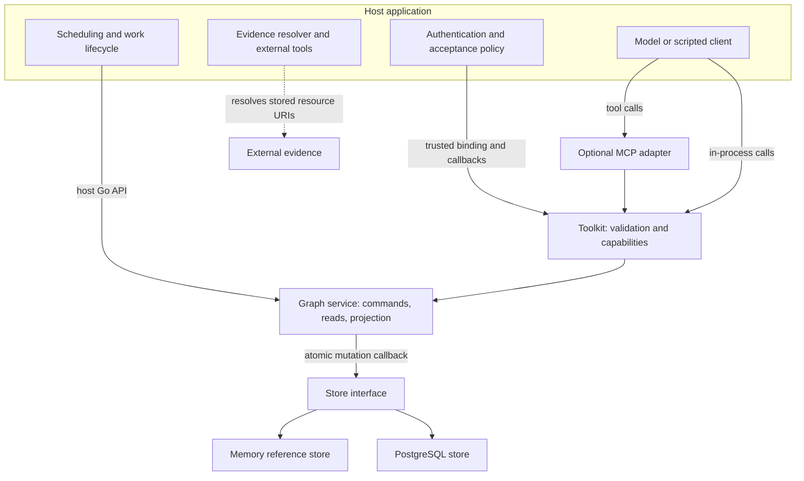

# Architecture

[Documentation](README.md) · [Agents](01-agents.md) · [Go library](02-go-library.md) · [MCP](03-mcp.md) · [Workflow](04-workflow.md) · [Architecture](05-architecture.md) · [Storage](06-storage.md) · [Operations](07-operations.md) · [Roadmap](08-roadmap.md)

The toolkit exposes narrow graph operations to agents. One Go command service owns
the graph rules, and both stores run those same rules. There is no model,
scheduler, or external evidence fetcher inside the core.

## Trace the system boundary



The host authenticates users and selects namespace, graph, actor, role, execution,
and acceptance grants. Those values are trusted configuration; model arguments
cannot replace them. The toolkit checks capabilities and optional authorization
on every invocation, including retries.

The host also runs models and ordinary tools, launches or cancels workers, resolves
evidence, and decides when the overall task is complete. A met goal does not
automatically close a graph, terminate workers, or complete a task.

## Choose the entry point

- **Go host:** call `graph.Service` directly for creation, lifecycle, revision,
  dependency, acceptance, and snapshot operations.
- **Embedded agent:** bind `toolkit.Adapter` to a graph and invoke its eight
  schema-validated tools with host-issued invocation identities.
- **MCP:** `adapters/mcp` wraps the same toolkit with the official SDK.
  `cmd/graph-mcp` supplies a local stdio process for one existing graph and actor.

MCP adds transport and session instructions, not another semantic implementation.
The stdio binary does not migrate storage, create graphs, schedule work, or serve
authenticated remote clients. See [MCP](03-mcp.md) for configuration.

## Read the graph's vocabulary

An `origin` captures the original request or background. A `goal` carries acceptance
criteria. A `work_item` records proposed or performed work. An `observation`
records a result, a `conclusion` synthesizes supported claims, and a `hint` provides
steering input. Origin text is not independently verified evidence.

Evidence payloads label claims `observed`, `inferred`, or `reported`. That label is
separate from active/retracted state and from whether a goal has been accepted.
An observed statement can still be wrong; the library checks structure and lineage.

Five relation types have fixed directions:

```text
spawns        origin → goal
derived_from  origin / observation / conclusion → work_item
yields        work_item → observation / conclusion
supports      observation / conclusion → conclusion / goal
depends_on    dependent work_item → prerequisite work_item
```

These are the endpoint rules enforced by `graph/service.go`. Self-edges are
rejected. Support and dependency cycles are rejected. A hint has no relation type
in this release; the host records and consumes it through dedicated commands.

`derived_from` means “this source motivated that work,” despite the relation's
name. `depends_on` points from work that must wait to its prerequisite. Keep the
two meanings separate when traversing or presenting the graph.

## Follow a command through a transaction

For a mutation, the service validates context and size, computes a request hash,
and calls the store's update callback. PostgreSQL locks the graph row first.
Inside that boundary the service:

1. Checks whether the request ID already committed and replays its stored result
   or rejects changed input with `idempotency_conflict`.
2. Checks graph revision when requested, graph state, and any execution binding.
3. Validates node revisions, payloads, relations, freshness, and lifecycle rules.
4. Applies all node, edge, resource, and acceptance changes together.
5. Increments the graph revision, checks the success envelope size, and appends
   one event containing the request identity/hash and committed result.

The store commits the entire change atomically. A callback or persistence failure
leaves no partial graph mutation. Node history and provenance remain available;
the service appends revisions rather than editing prior payloads.

The PostgreSQL store writes normalized differences to seven tables. Its
`UpdateRequest` extension retrieves only the matching request event, avoiding an
event-history load for every command. Mutations still load all node history,
edges, references, and acceptances in that graph.

## Separate three kinds of version

**Node revision:** a version of one node's state, title, and payload. Existing-node
mutations normally require its current revision. Evidence and provenance links pin
exact revisions; dependency links intentionally do not.

**Graph revision:** the order of committed mutations in a graph. A command can
change several nodes while creating one graph revision and event. A replay returns
its original graph revision even if the graph has since advanced.

**Contract version:** release 0.2.0 implements tool contract 0.2, prompt assets
version 1, and supported snapshot schema set `{1}`. See
[Compatibility](COMPATIBILITY.md) for change policy.

## Understand freshness and acceptance

Reads compute evidence freshness by following exact incoming support revisions.
A current active observation is fresh. A conclusion is fresh only when it has
support for its current revision and that recursive evidence closure is fresh.
Other node kinds report `not_applicable`.

`AcceptGoal` selects direct support to an open or `needs_review` goal, validates
the recursive closure, records that closure and its resources, and appends a met
goal revision. A support edge alone cannot mark a goal met.

Revising or retracting reviewed evidence invalidates affected current acceptances;
met goals move to `needs_review`. Historical edges and acceptance records remain.
The host reviews the correction and explicitly accepts again. Acceptance records
who approved which evidence; it does not verify external content itself.

## Resume with bounded context

`ProjectContext` provides origin, non-abandoned goals, and assigned work as
mandatory anchors. Optional candidates favor active hints, running work, eligible
open work, and recent active evidence; eligible work priority affects ordering.
Edges are considered only when both endpoint nodes fit.

The projection reports totals, omissions, truncation, retrieval routes, and graph
revision. It omits whole records to meet the byte budget; it does not summarize
them with a model. If mandatory anchors cannot fit, it returns `budget_too_small`.
Use `GetNode`, `ListNodes`, or the host snapshot path to retrieve omitted details.

Ordinary reads use `ReadScoped`: current nodes and all edges, plus history and
references for a requested detail node. They are consistent detached views, not
portable snapshots. Event polling has its own bounded `EventsAfter` path.

## Plan for the current scaling boundary

Per-graph row locking serializes mutations. It protects claims, dependencies, and
acceptances; it is not a high-throughput distributed scheduling system. Worker
execution IDs fence graph writes after reassignment; they are not timed leases and
cannot fence external side effects.

Bounded output does not mean bounded database work. Ordinary reads still load every
current node payload and edge, and mutations load full content history. The memory
store uses a store-wide mutex and clones state. No production throughput guarantee
is made. Measurements and method limitations are in
[PostgreSQL verification](POSTGRES-VERIFICATION.md#remaining-bounds-not-solved-in-this-unit).

For persistence and restore details, read [Storage](06-storage.md). For normative
rules, use [SPEC](../spec/SPEC.md), [TOOLS](../spec/TOOLS.md), and the recorded
[architecture decisions](DECISIONS.md); the guides do not replace those contracts.
