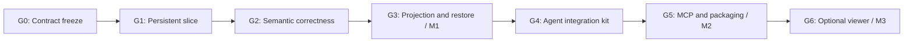

# Exploration graph tool: orchestration game plan

Planning baseline: October 27, 2026; contract v0.2 is approved by [DECISION 012](../docs/DECISIONS.md#012-contract-freeze-and-candidate-version). This plan records the original work sequence and acceptance gates; implementation is present and corrected source `62c083f422be2f25e538724179c9fa142bd17e91` passed the Go 1.25.0 and 1.27.3 runtime matrix. Local source delivery was approved after preflight inspection at `9da1e0b9e33aba4a2aef9fb79b9a85f67d76433d`. Evidence is tracked in [CLEAN-ENVIRONMENT.md](../docs/CLEAN-ENVIRONMENT.md) and [RELEASE-SIGNOFF.md](../docs/RELEASE-SIGNOFF.md).

## Delivery objective

Build a portable tool that a harness can use to remember goals, assign work, record evidence, and resume without relying on a long conversation. Prove the behavior with an in-process scripted harness and an MCP adapter before building a UI. Keep the existing SPEC.md, TOOLS.md, and schemas as the reviewable contract.

Three milestones:

- M1 core library: semantics, PostgreSQL durability, context projection, snapshot restore, and deterministic conformance suite.
- M2 portable tool: role-aware integration kit, in-process adapter, stdio MCP adapter, prompt fragments, and equivalent end-to-end fixtures.
- M3 optional viewer: read-only web UI driven by snapshots and events. No dependency from M1/M2 on M3.



These arrows are completion gates. Integration contract tests can begin after G0 using a fake service; they cannot satisfy G4 until the real G3 service passes.

## Ownership and coordination

Use one integrator with authority over shared contracts and release gates. If parallel development is available, use three implementation lanes after G0: core semantics, PostgreSQL storage, and tool integration. A single engineer can execute these lanes in the same dependency order. Do not parallelize schema design itself across independent implementations.

Integrator owns SPEC.md, TOOLS.md, schema/*, public service/store interfaces, fixture definitions, compatibility decisions, and merges. Core lane owns graph command validation/state transitions and memory semantics. Storage lane owns store/postgres migrations, transactional primitives, and database race/failure tests. Integration lane owns toolkit, transport adapters, prompt assets, examples, and adapter contract tests. A reviewer checks invariants and evidence for each gate; reviewers do not replace tests.

Shared-file changes go through the integrator before dependent work continues. Assign separate branches/worktrees only when implementation begins. Each work packet must name its base commit, scope, owned paths, allowed dependency changes, acceptance commands, and handoff evidence. Avoid unbounded assignments such as "build the graph backend."

Handoff template:

```text
Work packet / gate:
Base commit and contract version:
Owned paths and dependencies:
Required behavior and non-goals:
Validation commands and actual results:
Public interface/schema changes:
Known limitations or unresolved decisions:
Commit/PR and next consumer:
```

## G0 — Freeze the executable contract

Owner: integrator. All other lanes depend on this gate.

- Create a dedicated repository/module; the current research folder is not the implementation repository.
- Confirm module/package name, license/distribution choice, supported Go/PostgreSQL versions, and MCP protocol/SDK version from current official documentation.
- Adopt the semantic contracts here, or record explicit decisions changing them before implementation. Do not silently inherit ARTEX behavior where the spec deliberately differs.
- Define typed command inputs, result/error types, trusted execution context, and a transaction interface shared by both storage adapters. Keep model-facing tool inputs distinct from host command context.
- Create test fixtures for a parser investigation, a negative result, evidence revision, competing work claims, stopped/retried workers, and source snapshot restore.
- Validate input/output schema examples and set CI to fail on contract drift. Add result schemas during this gate; current tool-contracts.json covers inputs only.

Exit evidence: a reviewed contract commit, schema checks passing, and compile-only interface stubs. No database behavior or model behavior is claimed at this point. Public interfaces may change only by a contract PR after this gate.

## G1 — Complete a narrow persistent vertical slice

Owners: core + storage; integrator merges the contract-dependent work in order. Integration can build its fake service/contract tests in parallel after G0.

Implement CreateGraph, AddGoal, ProposeWork, TransitionWork, RecordObservation, GetNode, and a minimal current overview. Use the same command service with memory and PostgreSQL transactional adapters. Start with one graph lock per write; do not add distributed queues or an ORM abstraction beyond the required transaction primitives.

Scripted scenario: create a parser goal → propose reproduction → claim with execution ID → record an observed failure with a log reference → finish work → restart the service → read the persisted result. Exercise a lost response by committing a write, dropping its response, and retrying the same invocation.

Exit evidence: PostgreSQL test DB required in CI; restart survives; exactly one result/event for the retry; two concurrent claims yield one winner; an injected failure between node and edge insertion rolls back both. A copied SQL schema alone cannot satisfy this gate.

## G2 — Finish semantic correctness

Owner: core with storage support. Depends on G1.

Implement conclusions, supports, acceptance, revisions/retractions, hints, goal/work/graph lifecycle, and dependency edits. Enforce expected revisions and worker execution identities under the graph lock. Test fresh support recursively through intermediate conclusions. Implement conservative acceptance invalidation and preserve its reviewed closure.

Required adversarial scenarios:

- A current conclusion cites an old observation revision: acceptance fails.
- Revising a reviewed observation invalidates all affected current acceptances atomically; unrelated goals stay met.
- The acceptance's own goal transition does not invalidate itself.
- Concurrent A-depends-on-B and B-depends-on-A cannot both commit.
- Dependency edits racing a claim cannot make running work ineligible retroactively.
- A stopped worker writes after another execution claims the same item: stale_execution.
- Host authorization refuses a forbidden mutation even when the caller supplies a valid graph/node ID.

Exit evidence: one reusable semantic suite passes against memory and PostgreSQL; database-only concurrency and rollback tests pass; expected errors are stable. The memory adapter alone does not establish database correctness.

## G3 — Make bounded reads and restore reliable

Owner: core/projection + storage. Depends on G2; projection work can begin against G0 interfaces earlier.

Implement full ProjectContext, node/edge traversal, cursor pagination, EventsAfter, consistent snapshots, and restore. Serialize exactly the response that is measured against byte budgets. Include omission counts and retrieval paths. Reject stale cursors rather than silently skipping/duplicating records after mutation. Restore only into a new graph identity and reject running source work.

Exit evidence: a larger fixture forces truncation without losing required goals/assignment; too-small budgets fail explicitly; a reader can retrieve omitted evidence; snapshot→restore preserves node history and acceptance semantics; inconsistent foreign references and unsupported versions are rejected without partial inserts; event consumers reconnect without missing committed revisions.

Benchmark on declared hardware with fixtures of 100, 1,000, and 10,000 nodes. Record latency, serialized bytes, query count, and memory for overview/traversal/invalidation. These are measurements to choose production limits, not a throughput promise in advance. Investigate unbounded queries or whole-history loads before declaring M1 complete.

## G4 — Deliver the agent integration kit

Owner: integration. Contract/fake-service work starts after G0; real completion depends on G3.

Implement the eight tools in TOOLS.md, strict schemas, stable error envelopes, role presets, bound producer context, and versioned prompt fragments. Build the deterministic in-process harness with durable invocation identity. Model calls are optional smoke tests, not the oracle for correctness.

The main demonstration uses two fresh agent-context instances: the first records the parser failure; the second sees only the graph projection plus ordinary task instructions, retrieves evidence, proposes a fix verification, records a passing result, and obtains goal acceptance through a policy-enabled caller. The deterministic fixture scripts tool decisions; a model-backed smoke test separately evaluates whether the prompts elicit the intended behavior.

Exit evidence: read/write tool schema conformance; worker cannot call planner-only tools; actor/graph/producer spoofing is rejected; empty-result work is handled explicitly; stale_execution stops the old worker; both expected model-call traces and actual scripted service state are available for review. Complete the real-host lifecycle before asserting that registering tools is sufficient integration.

## G5 — Package for another harness

Owner: integration, reviewed by integrator. Depends on G4.

Implement a stdio MCP adapter bound to one configured graph/actor/role. Validate tool discovery, calls, structured errors, lifecycle shutdown, and connection loss against the pinned protocol/SDK. Run the same scripted scenario through a protocol client and the in-process adapter and compare normalized graph snapshots. Generated IDs/times are normalized; relations, revisions, states, and acceptance evidence must agree.

Document minimal host integration, configuration, execution binding, invocation/retry behavior, evidence resolver responsibility, and limits. Demonstrate with a second consumer outside the Go API. A generic MCP client without durable invocation identity must surface ambiguous-write recovery instead of retrying blindly.

Exit evidence: install/start instructions work in a clean environment; no ARTEX/Norma import or service is required; adapter parity tests pass; no silent permission expansion; release artifacts contain schema version, migration, examples, and compatibility notes. M2 is complete. An actual ARTEX integration can now be an independent adapter project.

## G6 — Add the optional web viewer

Owner: UI lane created only after M2, or earlier against a frozen read fixture if separately staffed. Depends on G3 read contracts; live integration depends on M2.

Build a thin authorized read API and viewer for goals, queued/running work, observations/conclusions, lineage, and acceptance evidence. Add a node inspector with exact revision and evidence links, filters by relation/kind/state, and explicit stale/historical styling. Keep visual layout and collapsed groups out of core graph semantics. Use event revisions to refresh affected views; refetch a snapshot after gaps or stale cursors.

Exit evidence: a fresh browser reflects scripted mutations and evidence invalidation; reconnect recovers current state; large fixtures remain navigable; unauthorized graph reads fail; keyboard navigation and readable non-graph lists exist. Editing, execution controls, and remote multi-tenant deployment are later scope decisions.

## Merge and review rhythm

Maintain a small queue of gate-sized PRs: contracts; vertical-slice service; PostgreSQL correctness; evidence/acceptance semantics; projection/restore; toolkit; MCP integration; optional viewer. Split further when a PR crosses unrelated ownership boundaries. Keep the default branch passing; integrate the smallest coherent slice before branching dependent work.

Before merging, the owner supplies actual test commands/results and the reviewer checks the relevant invariant list. The integrator runs the combined fixture after each lane merges. If an interface changes, stop affected dependent work, update schemas/fixtures first, and notify its owners; do not let adapters compensate with local special cases.

At each gate record: completed behavior, test evidence, remaining risks, contract changes, and the next bounded work packets. Do not ask an orchestrator to keep polishing indefinitely. Failed gates return to the owning lane with a reproducible failure and explicit exit criterion.

## Estimate and first assignment

For one experienced engineer, budget roughly 2–4 weeks for G0–G3 and another 1–2 weeks for G4–G5, revising the range after G1. Parallel lanes reduce some elapsed time but add interface/review work; do not divide the estimate by agent count. UI and live ARTEX migration are separate estimates.

First assignment: freeze the G0 contracts and implement only the G1 PostgreSQL vertical slice. Require a durable observation, safe retry, competing-claim test, and a restart demo before broadening scope. This tests the hardest architectural assumption—one semantic service with durable atomic behavior—before spending effort on transports or a graph canvas.
